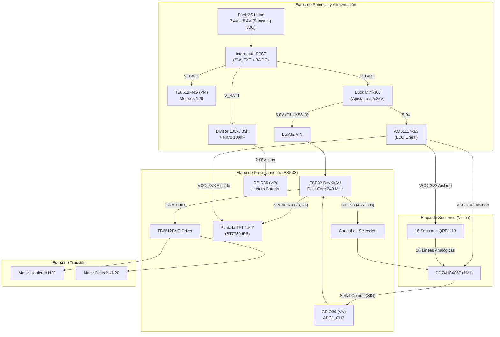

# 🏎️ Robot Seguidor de Línea de Alta Velocidad (IDLine ESP32 Edition)

[-red.svg)](https://www.espressif.com/)
[-blue.svg)]()
[-green.svg)]()
[-orange.svg)]()
[]()
[]()

> Proyecto de desarrollo de un **Robot Seguidor de Línea de Competencia** de alto rendimiento, evolucionado a partir de la plataforma de código abierto **IDLine**. Incorpora una arquitectura de procesamiento de doble núcleo (ESP32), sistema de visión modular escalable de 8 a 16 canales analógicos, distribución de potencia triplemente aislada contra caídas de tensión (*brownouts*) y telemetría gráfica a bordo.

---

## 📑 Tabla de Contenidos

1. [Características Principales](#-características-principales)
2. [Especificaciones Técnicas](#-especificaciones-técnicas)
3. [Arquitectura del Sistema](#-arquitectura-del-sistema)
4. [Distribución de Potencia Triplemente Aislada](#-distribución-de-potencia-triplemente-aislada)
5. [Sistema de Visión Modular (8 a 16 Sensores)](#-sistema-de-visión-modular-8-a-16-sensores)
6. [Mapeo de Pines del Microcontrolador (Pinout)](#-mapeo-de-pines-del-microcontrolador-pinout)
7. [Arquitectura Mecánica y Modular (Estructura de Pisos)](#-arquitectura-mecánica-y-modular-estructura-de-pisos)
8. [Catálogo de Componentes Principales](#-catálogo-de-componentes-principales)
9. [Estructura del Proyecto y Documentación](#-estructura-del-proyecto-y-documentación)
10. [Autor y Créditos](#-autor-y-créditos)

---

## 🚀 Características Principales

* **Controlador de Doble Núcleo (Dual-Core 240 MHz):** Migración desde microcontroladores básicos a la arquitectura **ESP32 DevKit V1 (38 pines)**. Permite desacoplar por software el lazo crítico de control PID a alta velocidad ($\ge 1\,\text{kHz}$ en Core 1) de la telemetría en pantalla y captura de pulsadores (Core 0 con FreeRTOS).
* **Sistema de Visión Híbrido y Desmontable (8 / 16 Canales):**
  * **Barra Central Fija:** Módulo de 8 fototransistores reflectivos para seguimiento estable en rectas y curvas amplias.
  * **Dos Aletas Laterales Desplegables:** 4 sensores miniatura **QRE1113** por aleta para curvas de 90°, horquillas cerradas y recuperación rápida tras pérdida de trayectoria.
  * **Multiplexado Analógico de Alta Velocidad:** Uso del integrado **CD74HC4067**, leyendo los 16 sensores con un único canal ADC del microcontrolador y 4 líneas digitales de selección.
* **Topología de Potencia Aislada en 3 Rieles:**
  * Separación física entre la potencia de motores ($V_{BATT}$ directo al driver), la lógica digital (5.0V Buck) y la alimentación analógica sensible (3.3V lineal dedicado) para suprimir ruidos inductivos y evitar reinicios inesperados.
* **Telemetría Gráfica en Tiempo Real:**
  * Pantalla a color **TFT IPS de 1.54" (ST7789, 240×240 px)** para calibración interactiva de umbrales blanco/negro en pista, monitorización de voltaje por celda y ajuste dinámico de constantes PID ($K_p, K_i, K_d$).
* **Cumplimiento Estricto de Reglamento:**
  * Diseñado dentro de los límites estándar de competencia internacional ($< 20 \times 15\,\text{cm}$).

---

## 📊 Especificaciones Técnicas

| Parámetro | Especificación |
| :--- | :--- |
| **Microcontrolador** | ESP32 DevKit V1 (Xtensa® Dual-Core LX6 @ 240 MHz, 520 KB SRAM) |
| **Sensores de Pista** | 8 a 16 Sensores Infrarrojos Reflectivos (QRE1113 SMD, 940 nm) |
| **Multiplexor Analógico** | Texas Instruments CD74HC4067 (16:1, $R_{ON} \approx 70\,\Omega$) |
| **Driver de Motores** | Toshiba TB6612FNG (Puente H Dual MOSFET, 1.2A cont. / 3.2A pico por canal) |
| **Actuadores** | 2× Micromotores N20 metálicos con reductora (All-Metal Spur Gearbox) |
| **Pantalla / UI** | Pantalla TFT IPS 1.54" SPI ST7789 (240×240 píxeles) + 2 Pulsadores táctiles |
| **Batería** | Pack 2S Li-Ion (Samsung INR18650-30Q, 7.4V nom, 8.4V máx, 3000 mAh, 15A CDR) |
| **Regulación Primaria** | Convertidor Buck síncrono Mini-360 (MP2307DN, entrada 7.4-8.4V $\rightarrow$ salida 5.35V) |
| **Regulación Analógica** | Regulador lineal LDO AMS1117-3.3 (salida filtrada $3.3\,\text{V}$ dedicada) |
| **Monitoreo de Batería** | Divisor resistivo optimizado $100\,\text{k}\Omega / 33\,\text{k}\Omega$ ($2.08\,\text{V}$ máx @ 8.4V en ADC1_CH0) |
| **Dimensiones Máximas** | Envolvente de competencia: Largo $\le 180\,\text{mm}$ \| Ancho $\le 135\,\text{mm}$ (Reglamento: $200 \times 150\,\text{mm}$) |

---

## 🧩 Arquitectura del Sistema



---

## ⚡ Distribución de Potencia Triplemente Aislada

Para evitar los comunes bloqueos por *Brownout* y falsas lecturas analógicas causadas por el ruido de conmutación de los motores, el circuito organiza la energía en **tres rieles independientes**:

```
[Batería 2S 7.4V - 8.4V] ───────────────► Riel V_BATT (Motores N20 + VM del TB6612)
          │
    [Mini-360 Buck] ────────────────────► Riel 5.0V (ESP32 VIN mediante Diodo Schottky)
          │
    [AMS1117-3.3 LDO] ──────────────────► Riel 3.3V Aislado (Sensores QRE1113, TFT, MUX y Lógica TB6612)
```

### Justificación Técnica del Divisor `BATT_SENSE` (100 kΩ / 33 kΩ)

El monitoreo de batería utiliza un divisor de tensión resistivo conectado al canal analógico **GPIO36 (VP / ADC1_CH0)**:

$$V_{adc} = V_{bat} \times \frac{33\,\text{k}\Omega}{100\,\text{k}\Omega + 33\,\text{k}\Omega} \approx 2.083\,\text{V a carga completa (8.4 V)}$$

* **¿Por qué 33 kΩ y no 22 kΩ?**  
  Una resistencia de $22\,\text{k}\Omega$ está calculada para baterías 3S ($12.6\,\text{V}$). En una batería 2S, $22\,\text{k}\Omega$ entregaría solo $1.52\,\text{V}$, desaprovechando cerca del $40\%$ del rango dinámico del convertidor de 12 bits. Con $33\,\text{k}\Omega$ se alcanzan **$2.08\,\text{V}$**, situándose en el tramo de máxima linealidad del ADC del ESP32 (atenuación de 11 dB, lineal entre $0.15\,\text{V}$ y $2.45\,\text{V}$) y obteniendo un $+32\%$ de resolución en la detección de descarga.

---

## 👁️ Sistema de Visión Modular (8 a 16 Sensores)

Los 16 canales del multiplexor analógico bidireccional **CD74HC4067** se organizan en tres grupos geométricos continuos:

```
                  [ DIRECCIÓN DE AVANCE ]
   Aleta Izquierda           Barra Central           Aleta Derecha
┌──────────────────┐    ┌─────────────────────┐    ┌──────────────────┐
│ C0  C1   C2   C3 │    │ C4 C5 C6 C7 C8 C9 C10 C11 │ │ C12 C13 C14 C15 │
└──────────────────┘    └─────────────────────┘    └──────────────────┘
  (Exterior → Centro)     (Extremo Izq → Extremo Der)   (Centro → Exterior)
```

| Canales | Bloque Físico | Descripción | Modo de Uso |
| :---: | :---: | :--- | :---: |
| **C0 – C3** | Aleta Izquierda | 4 sensores individuales QRE1113 desmontables | Curvas cerradas / Horquillas |
| **C4 – C11** | Barra Central | 8 sensores lineales integrados (Paso estándar) | Rectas y curvas suaves |
| **C12 – C15** | Aleta Derecha | 4 sensores individuales QRE1113 desmontables | Curvas cerradas / Horquillas |

* **Modo 8 Sensores:** Conectores de aletas desconectados. Mayor velocidad en pistas sencillas al reducir inercia y tiempo de cómputo.
* **Modo 16 Sensores:** Ambas aletas conectadas. Máxima cobertura espacial para detección temprana de curvas agudas en ángulo recto.

---

## 📌 Mapeo de Pines del Microcontrolador (Pinout)

Asignación definitiva de pines del **ESP32 DevKit V1 (38 pines)** respetando las restricciones de arranque (*boot strapping*), buses SPI de hardware y separación de canales ADC:

| Pin Físico | GPIO | Etiqueta | Función / Conexión | Notas de Diseño |
| :--- | :--- | :--- | :--- | :--- |
| **P36** | `GPIO36` | `BATT_SENSE` | Entrada analógica voltaje batería (ADC1_CH0) | Pin solo entrada (*input-only*). Sin pull-up interno. |
| **P39** | `GPIO39` | `MUX_SIG` | Entrada analógica común de sensores (ADC1_CH3) | Pin solo entrada. Sin interferencia con Wi-Fi (ADC1). |
| **P32** | `GPIO32` | `BTN_CALIB` | Pulsador de calibración blanco/negro en pista | Entrada digital con pull-up de $10\,\text{k}\Omega$ a $VCC_{3V3}$. |
| **P33** | `GPIO33` | `BTN_START` | Pulsador de inicio de carrera | Entrada digital con pull-up de $10\,\text{k}\Omega$ a $VCC_{3V3}$. |
| **P27** | `GPIO27` | `MUX_S0` | Línea de selección S0 (bit 0) del CD74HC4067 | Salida digital rápida. |
| **P14** | `GPIO14` | `MUX_S1` | Línea de selección S1 (bit 1) del CD74HC4067 | Salida digital rápida. |
| **P13** | `GPIO13` | `MUX_S2` | Línea de selección S2 (bit 2) del CD74HC4067 | Salida digital rápida. |
| **P15** | `GPIO15` | `MUX_S3` | Línea de selección S3 (bit 3) del CD74HC4067 | Salida digital rápida. |
| **P12** | `GPIO12` | `STBY` | Habilitación de puente H TB6612FNG | Pin de strapping: lleva pull-down externo de $10\,\text{k}\Omega$ a GND. |
| **P21** | `GPIO21` | `M1_IN1` | Dirección A del Motor Izquierdo (AIN1) | Salida digital hacia TB6612. |
| **P22** | `GPIO22` | `M1_IN2` | Dirección B del Motor Izquierdo (AIN2) | Salida digital hacia TB6612. |
| **P4** | `GPIO4` | `M1_PWM` | PWM de velocidad Motor Izquierdo (PWMA) | Canal MCPWM / LEDC por hardware. |
| **P25** | `GPIO25` | `M2_IN1` | Dirección A del Motor Derecho (BIN1) | Salida digital hacia TB6612. |
| **P26** | `GPIO26` | `M2_IN2` | Dirección B del Motor Derecho (BIN2) | Salida digital hacia TB6612. |
| **P17** | `GPIO17` | `M2_PWM` | PWM de velocidad Motor Derecho (PWMB) | Canal MCPWM / LEDC por hardware. |
| **P18** | `GPIO18` | `SPI_SCK` | Reloj SPI para pantalla ST7789 | Bus hardware VSPI nativo. |
| **P23** | `GPIO23` | `SPI_MOSI` | Datos SPI para pantalla ST7789 | Bus hardware VSPI nativo. |
| **P19** | `GPIO19` | `TFT_DC` | Selector Datos / Comando pantalla TFT | Salida digital. |
| **P5** | `GPIO5` | `TFT_CS` | Chip Select pantalla TFT | Salida digital. |
| **P16** | `GPIO16` | `TFT_RST` | Reset por hardware pantalla TFT | Salida digital. |

---

## 🏗️ Arquitectura Mecánica y Modular (Estructura de Pisos)

Siguiendo el estándar de los vehículos autónomos de competición, el diseño desacopla la altura de sensado de la altura de tracción mediante una estructura modular de **3 niveles**:

```
  [ NIVEL 3: INTERFAZ / COCKPIT ]
  ┌───────────────────────────────┐
  │  Pantalla TFT IPS + Botones   │  ← Elevado a 15 mm sobre separadores de nylon.
  └───────────────┬───────────────┘    Accesible en la línea de largada sin tocar la potencia.
                  │ (Conector Header / Cables)
  [ NIVEL 2: PLACA MADRE / CHASIS ]
  ┌───────────────┴───────────────┐
  │ ESP32 + Potencia + Regulador  │  ← Nivel estructural a 10 mm del suelo.
  │ Pack Baterías 2S + Motores    │    Centro de gravedad ultra bajo.
  └───────────────┬───────────────┘
                  │ (Soporte mecánico / Conector)
  [ NIVEL 1: PISO DE SENSORES ]
  ┌───────────────┴───────────────┐
  │ Barra Central 8S + 2 Aletas   │  ← A ras de suelo (1.5 - 2.5 mm de la pista).
  └───────────────────────────────┘    Distancia focal óptica óptima.
```

---

## 📦 Catálogo de Componentes Principales

Para especificaciones detalladas de cada elemento comercial, dimensiones e imágenes de referencia, consulta el catálogo técnico completo:

📄 **[Catálogo de Componentes Detallado (docs/catalogo_componentes.md)](docs/catalogo_componentes.md)**

* **Controlador:** Módulo ESP32 DevKit V1 (38 pines, USB Tipo C).
* **Driver de Motores:** Breakout Toshiba TB6612FNG con capacitor de desacoplo de 100 nF local en pines 2 (VCC) y 3 (GND).
* **Pantalla:** Módulo TFT Color 1.54" IPS con controlador ST7789 (SPI).
* **Multiplexor:** Módulo Breakout CD74HC4067 de 16 canales.
* **Sensores Ópticos:** Módulo barra central 8 canales (configuración actual activa en Placa de Sensores) + soporte escalable para 8 módulos individuales QRE1113 en aletas.
* **Regulación:** Step-Down Buck Mini-360 (MP2307) + LDO lineal AMS1117-3.3.
* **Pasivos para Placa Perforada:** Resistencias y capacitores Through-Hole (con patitas) y diodo Schottky 1N5819.
* **Baterías:** Celdas cilíndricas 18650 Samsung INR18650-30Q (3000 mAh, 15A continuo) en pack 2S serie.
* **Interruptor de Encendido:** Switch externo clasificado para $\ge 3\,\text{A DC}$ con cables AWG 18-20.

---

## 📁 Estructura del Proyecto y Documentación

```text
├── GEMINI.md                               # Contexto maestro y fuente de la verdad para el asistente IA
├── README.md                               # Presentación general y especificaciones del proyecto (este archivo)
├── docs/                                   # Documentación técnica y catálogo
│   ├── bitacora_seguidor.md                # Registro cronológico del proyecto, decisiones y fases
│   ├── catalogo_componentes.md             # Catálogo técnico de los componentes con imágenes y pinout
│   ├── Catalogo_Componentes_Seguidor_Linea.docx
│   └── assets/                             # Fotografías recortadas de los componentes reales
├── hardware/                               # Guías de armado físico, DIYLC y Esquemático
│   ├── guia_placa_madre_y_ensamble.md      # Guía de conexiones, componentes pasivos y checklist de taller
│   ├── guia_placa_sensores_8ch.md          # Diseño de la Placa de Sensores (8 canales + conector J_MAIN 7p)
│   ├── diylc/                              # Layouts de placa perforada en DIY Layout Creator (.diy)
│   └── esquematico/                        # SCH_IDLine_2026-09-21.json (Esquemático base en EasyEDA)
├── firmware/                               # Código fuente del ESP32 (próxima fase)
├── tools/                                  # Scripts de soporte y auditoría de netlist
│   └── easyeda_audit/                      # analyzer.py y netlist_report.md
└── reference/                              # Material externo de referencia (ignorado por defecto)
    └── idline_original/                    # Repositorio original IDLine (ESP32-C3/S2)
```

---

## 👨‍💻 Autor y Créditos

* **Diseño y Desarrollo de Hardware:** Samuel (`8samueldavid`)
* **Proyecto de Referencia Base:** Plataforma de código abierto **IDLine**
* **Herramientas Utilizadas:** DIYLC (DIY Layout Creator para placa perforada), EasyEDA (esquemático), VS Code, Python.
* **Fecha de Revisión Técnica:** Octubre de 2026 (Versión 1.2 — Arquitectura Modular 2 Placas en Perfboard)

---
*Diseñado para competencias de robótica de alta velocidad y proyectos de robótica móvil aplicada.*
