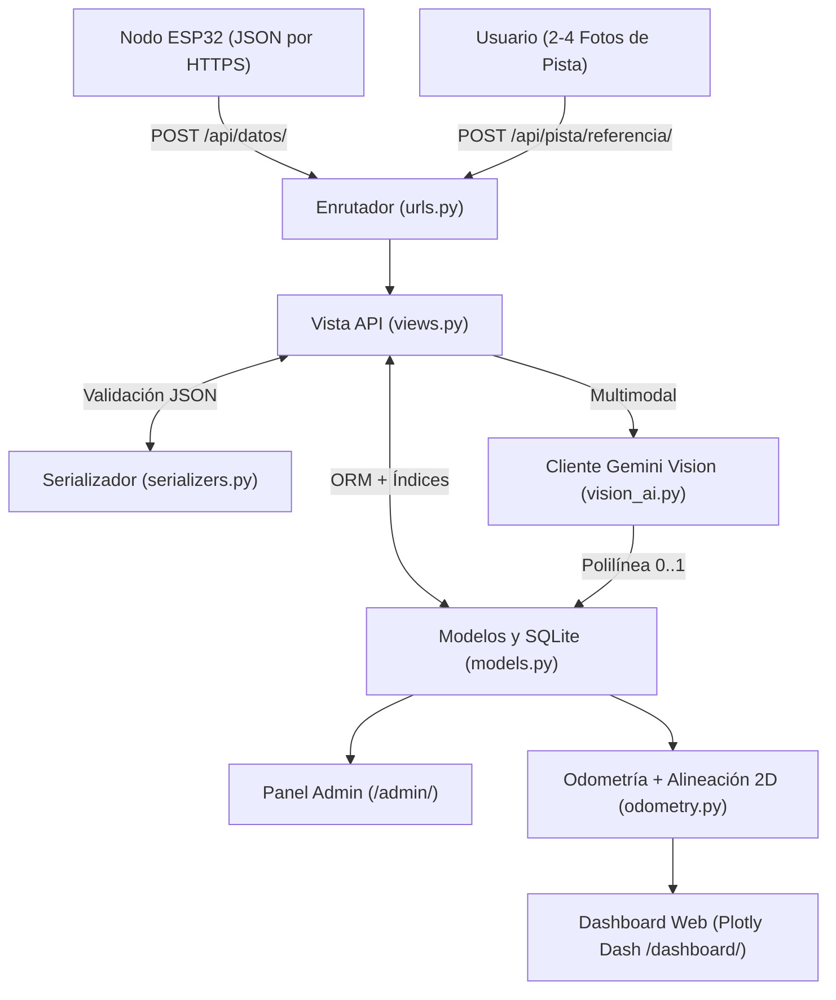
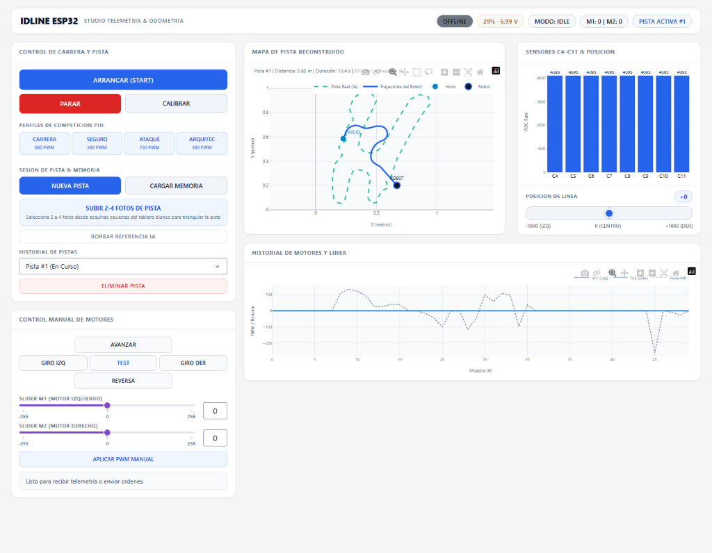

# Sistema Web de Telemetría IoT, Visión IA Multi-Vista y Control Bidireccional en la Nube usando Django y PythonAnywhere

**Autores:** Samuel David López Rincón, María Fernanda Mora  
**Programa:** Facultad de Ingeniería, Programa de Ingeniería de Sistemas y Computación  
**Docente:** Ing. Camilo Andrés Mendivelso Fajardo  
**Fecha:** Noviembre de 2026  

---

## Resumen
Este documento presenta el diseño, implementación y validación de una arquitectura web IoT basada en Django, Django REST Framework y Plotly Dash desplegada en PythonAnywhere para el monitoreo, reconstrucción visual y control remoto de un robot seguidor de línea. Siguiendo el flujo Base de Datos → Modelos → Serializador → Vista → Enrutador → Panel de Administración, el sistema recibe lecturas de sensores, voltaje de batería y estado de motores en formato JSON, despacha comandos de control en la misma respuesta HTTP, reconstruye la trayectoria recorrida por pista sin encoders y la alinea geométricamente contra una referencia real extraída mediante **Gemini Vision API (`gemini-3.8-flash`)** a partir de 2 a 4 fotografías multi-vista. Tras optimizar la reutilización de conexión HTTPS, indexar las tablas y evitar reconstrucciones innecesarias en el servidor, la latencia percibida pasó de más de 5 segundos a un promedio medido de **347.0 ms** en producción.

**Palabras clave:** *API REST, Django, Django REST Framework, Gemini Vision, IoT, Odometría, Plotly Dash, PythonAnywhere, SQLite, Telemetría.*

---

## I. Objetivos

### A. Objetivo General
Desarrollar un sistema web de telemetría, reconstrucción de pista asistida por visión artificial y control bidireccional en la nube para un robot seguidor de línea, mediante una API REST en Django, Django REST Framework, integración multimodal con Gemini Vision y un dashboard interactivo en Plotly Dash desplegados en PythonAnywhere, con el fin de recibir, almacenar, visualizar y analizar en tiempo real el comportamiento del robot con baja latencia.

### B. Objetivos Específicos
1. **Modelar y estructurar la persistencia de datos** mediante modelos relacionales e índices compuestos en Django sobre SQLite, con el fin de registrar cada corrida por pista, almacenar las referencias geométricas extraídas y gestionar las órdenes pendientes de forma ordenada.
2. **Implementar la validación y el intercambio bidireccional de paquetes JSON** mediante serializadores y vistas REST en Django, para almacenar la telemetría enviada por el robot y despachar comandos de control en la misma transacción HTTP.
3. **Integrar la reconstrucción geométrica de la pista real** mediante el envío multimodal de 2 a 4 fotografías desde esquinas opuestas a Gemini Vision API y un ajuste rígido 2D (Kabsch/Procrustes), con el propósito de compensar la perspectiva y contrastar la trayectoria odométrica del robot frente al circuito físico.
4. **Desarrollar un panel analítico y de mando en tiempo real** mediante Plotly Dash acoplado por WSGI a Django, para monitorear los sensores y la batería, operar el robot remotamente y gestionar visualmente las pistas registradas.
5. **Optimizar y medir la latencia de comunicación en producción** mediante la reutilización de sesión HTTPS, el ajuste de conexiones SQLite y la actualización selectiva de gráficas, con el fin de garantizar una respuesta fluida y comprobable entre el navegador, el servidor en PythonAnywhere y el robot.

---

## II. Arquitectura de Software en la Nube

El sistema sigue la arquitectura por capas de Django sobre PythonAnywhere conectada al robot por HTTPS. El nodo ESP32 envía periódicamente sus lecturas en JSON (8 sensores infrarrojos, velocidad PWM de ambos motores y voltaje de batería) y ejecuta las órdenes recibidas. De forma paralela, el operador puede cargar fotografías de la pista real desde el navegador para contrastar la trayectoria del robot.



### A. Base de Datos y Modelos (`models.py`)
La persistencia en SQLite se organiza en cuatro modelos principales:
- **`LecturaSensor`:** Registra `dispositivo_id`, `track_id`, arreglo `sensores`, PWM de motores `m1` y `m2`, `posicion`, voltaje `vbat_mv`, `modo`, ráfagas `muestras` y `timestamp`. Incluye índices compuestos en `(dispositivo_id, -id)` y `(dispositivo_id, track_id, id)` para acelerar las consultas por pista.
- **`EstadoRobot`:** Guarda la pista activa (`active_track_id`) y la fecha de última actualización.
- **`ComandoPendiente`:** Cola de órdenes remotas indexada por `(dispositivo_id, ejecutado, creado)`.
- **`PistaReferencia`:** Almacena por `(device_id, track_id)` la polilínea normalizada `points_json` (`[0.0, 1.0]`), el indicador de circuito cerrado (`closed`), la cantidad de vistas procesadas (`photo_count`) y metadatos de extracción sin almacenar imágenes binarias pesadas en SQLite.

### B. Serializador, Vistas, Visión IA y Enrutador (`serializers.py`, `views.py`, `vision_ai.py`, `urls.py`)
- **Serializador:** `LecturaSensorSerializer` traduce y valida el JSON entrante hacia objetos del ORM de Django.
- **Telemetría y Comandos (`POST /api/datos/`):** Guarda la telemetría recibida y, en la misma respuesta HTTP, consulta y marca como ejecutados hasta 5 comandos pendientes, evitando una segunda petición periódica de polling desde el robot.
- **Visión IA Multi-Vista (`POST/GET /api/pista/referencia/` y `vision_ai.py`):** Implementa un cliente REST ligero usando únicamente la librería estándar de Python (`urllib.request`, `json`, `base64`), leyendo `GEMINI_API_KEY` desde variables de entorno WSGI y soportando cargas de hasta **20 MB** (`DATA_UPLOAD_MAX_MEMORY_SIZE` en `settings.py`). Recibe de 2 a 4 fotografías tomadas desde esquinas opuestas, las envía en una única llamada multimodal a `gemini-3.8-flash` (timeout configurable de 120 s) usando las líneas de baldosas y bordes del área blanca para compensar la perspectiva, y valida/acota las coordenadas JSON al rango `[0.0, 1.0]`.
- **Enrutador y Admin:** `urls.py` mapea las rutas bajo `/api/` y `admin.py` registra los modelos con filtros por dispositivo, pista y modo.

### C. Despliegue WSGI, Alineación Geométrica 2D (`odometry.py`) y Dashboard (`Plotly Dash`)
El archivo `wsgi_pythonanywhere.py` integra Django (`/api/` y `/admin/`) junto con Flask/Dash (`/dashboard/`) dentro del entorno virtual `IoTAPI`.

En el módulo de odometría y visualización se implementaron:
1. **Reconstrucción y Alineación 2D (`odometry.py`):** `reconstruct_trajectory()` estima el desplazamiento $(x, y)$ a partir de los comandos PWM compensados por el voltaje real de la batería. Luego, `align_trajectory_to_reference()` aplica un ajuste de similitud 2D (**Kabsch/Procrustes**: traslación, rotación y escala uniforme mediante `math` estándar, con remuestreo por longitud de arco) para superponer la trayectoria del robot sobre la polilínea de `PistaReferencia` sin deformar curvas, permitiendo detectar deriva o sobreviraje real.
2. **Carga Multi-Vista y Limpieza Selectiva:** El panel incorpora `SUBIR 2-4 FOTOS DE PISTA` (`dcc.Upload(multiple=True)`), el botón **`BORRAR REFERENCIA IA`** para limpiar únicamente la referencia visual de la pista activa sin perder telemetría, y `ELIMINAR PISTA` para depurar lecturas y referencias asociadas.
3. **Indicadores y Control en Vivo:** Estado `ONLINE/OFFLINE`, porcentaje y voltaje de batería, perfiles de velocidad, control manual con feedback inmediato, barras de los 8 sensores e historial de motores y error de línea.

---

## III. Resultados y Evidencia de Optimización

### A. Reducción de Latencia de > 5 s a ~347 ms
Inicialmente el sistema presentaba retardos superiores a 5 segundos entre una orden en el navegador y su ejecución en el robot. Esta latencia se redujo a un promedio medido de **347.0 ms** mediante cuatro cambios concretos:

| Componente | Problema Inicial | Solución Aplicada |
| :--- | :--- | :--- |
| Conexión ESP32 → API | Negociaba un nuevo *handshake* TLS en cada POST | Reutilización de sesión HTTPS abierta (`keep-alive`) |
| Despacho de órdenes | 1 comando por ciclo HTTP | Entrega de hasta 5 comandos en la respuesta del POST |
| Consultas Dash en WSGI | Reconstruía todas las gráficas cada segundo sin datos nuevos | Polling ligero y reconstrucción solo al cambiar la última lectura |
| SQLite en PythonAnywhere | `CONN_MAX_AGE = 60` y consultas sin índices | `CONN_MAX_AGE = 0` e índices compuestos en tablas principales |

Registro real de 8 peticiones HTTPS consecutivas medidas contra el endpoint `/api/estado/` en producción tras aplicar las mejoras:

```text
req 1: HTTP 200 | 445.2 ms
req 2: HTTP 200 | 325.3 ms
req 3: HTTP 200 | 347.8 ms
req 4: HTTP 200 | 330.7 ms
req 5: HTTP 200 | 352.1 ms
req 6: HTTP 200 | 349.8 ms
req 7: HTTP 200 | 299.1 ms
req 8: HTTP 200 | 326.1 ms
Resumen: min = 299.1 ms | promedio = 347.0 ms | p95 = 445.2 ms
```


### B. Visualización, Pista Real (IA) y Operación en Producción
Captura del dashboard en operación en PythonAnywhere mostrando los indicadores de estado, lectura de batería, barras de sensores y la reconstrucción de la pista de la universidad extraída con Gemini Vision:



---

## IV. Conclusiones

1. **Arquitectura Django REST en la Nube:** Estructurar el servidor en modelos, serializadores, vistas, enrutador y panel administrativo permitió centralizar la recepción de telemetría, el despacho de comandos en una sola transacción HTTP y la persistencia de referencias por pista en SQLite.
2. **Reducción Comprobable de Latencia:** Al reutilizar la sesión HTTPS, indexar las consultas, ajustar `CONN_MAX_AGE = 0` para PythonAnywhere y evitar reconstrucciones innecesarias de gráficas en WSGI, la respuesta de la API bajó de más de 5 segundos a un promedio medido de **347.0 ms**.
3. **Visión IA Multi-Vista y Diagnóstico Geométrico:** Combinar Gemini Vision multi-vista (`gemini-3.8-flash`) con alineación rígida 2D (Kabsch/Procrustes) permite comparar el recorrido odométrico sin encoders directamente contra la geometría real de la pista universitaria, facilitando el ajuste fino del controlador PID.
