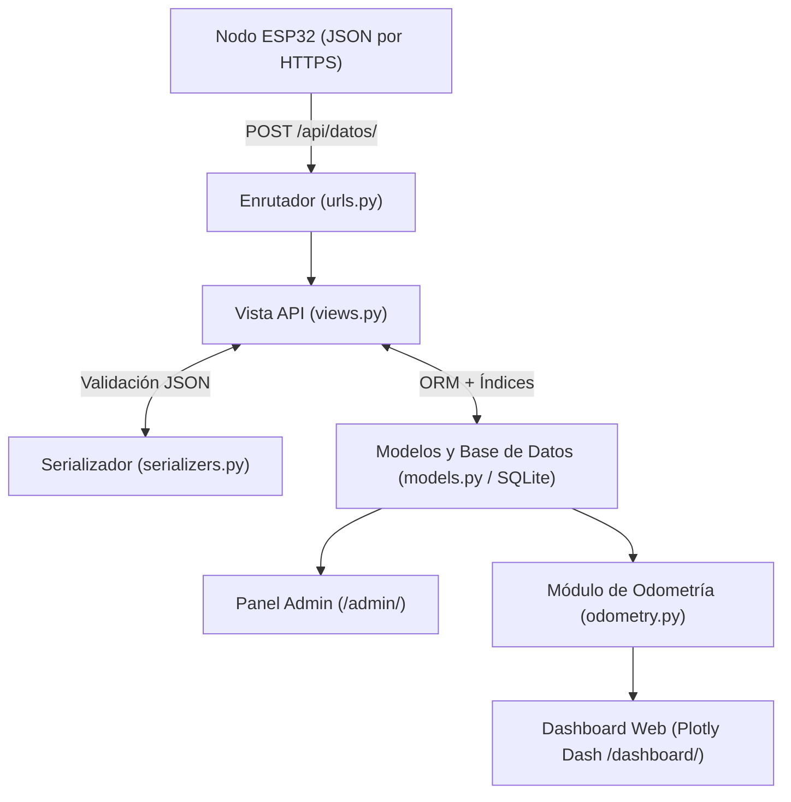
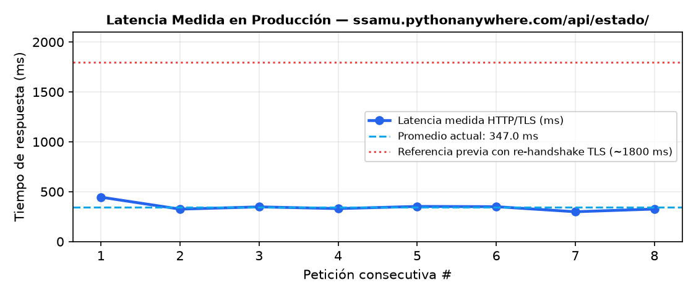

# Sistema Web de Telemetría IoT, Control Bidireccional y Visualización en la Nube usando Django y PythonAnywhere

**Autores:** Samuel David López Rincón, María Fernanda Mora  
**Programa:** Facultad de Ingeniería, Programa de Ingeniería de Sistemas y Computación  
**Docente:** Ing. Camilo Andrés Mendivelso Fajardo  
**Fecha:** Noviembre de 2026  

---

## Resumen
Este documento presenta el diseño, implementación y validación de una arquitectura web IoT basada en Django, Django REST Framework y Plotly Dash desplegada en PythonAnywhere para el monitoreo y control remoto de un robot seguidor de línea. Siguiendo el flujo Base de Datos → Modelos → Serializador → Vista → Enrutador → Panel de Administración, el sistema recibe lecturas de sensores, voltaje de batería y estado de motores en formato JSON, despacha comandos de control en la misma respuesta HTTP y reconstruye la trayectoria recorrida por pista sin usar encoders. Tras optimizar la reutilización de conexión HTTPS, indexar las tablas y evitar reconstrucciones innecesarias en el servidor, la latencia percibida pasó de más de 5 segundos a un promedio medido de **347.0 ms** en producción.

**Palabras clave:** *API REST, Django, Django REST Framework, IoT, Plotly Dash, PythonAnywhere, SQLite, Telemetría.*

---

## I. Objetivos

### A. Objetivo General
Desarrollar un sistema web de telemetría y control bidireccional en la nube para un robot seguidor de línea mediante una API REST en Django, Django REST Framework y un dashboard en Plotly Dash desplegados en PythonAnywhere con el fin de recibir, almacenar, administrar y visualizar en tiempo real el comportamiento del robot con baja latencia.

### B. Objetivos Específicos
1. **Modelar y estructurar la persistencia de datos** mediante modelos relacionales e índices compuestos en Django sobre SQLite para registrar cada corrida por pista y gestionar las órdenes pendientes de forma ordenada.
2. **Implementar la validación y lógica de recepción de paquetes JSON** mediante serializadores y vistas REST con el fin de almacenar la telemetría enviada por el robot y retornar comandos de control en la misma transacción HTTP.
3. **Configurar el enrutamiento, administración y despliegue WSGI en PythonAnywhere** mediante URLs dedicadas, registro en el panel de administración y entorno virtual para exponer los endpoints y la interfaz web de forma estable.
4. **Desarrollar un panel analítico y de mando en tiempo real** mediante Plotly Dash acoplado a Django con el propósito de monitorear los sensores, visualizar el porcentaje de batería, operar el robot remotamente y reconstruir su trayectoria.
5. **Optimizar y medir la latencia de respuesta en producción** mediante reutilización de conexión HTTPS, ajuste de conexiones SQLite y actualización selectiva de gráficas para garantizar una comunicación fluida entre el navegador y el robot.

---

## II. Arquitectura de Software en la Nube

El sistema sigue la arquitectura por capas de Django sobre PythonAnywhere conectada al robot por HTTPS. Como contexto físico mínimo, el nodo ESP32 envía periódicamente sus lecturas en JSON (8 sensores infrarrojos, velocidad PWM de ambos motores y voltaje de batería) y ejecuta las órdenes recibidas.



### A. Base de Datos y Modelos (`models.py`)
La persistencia en SQLite se organiza en tres modelos:
- **`LecturaSensor`:** Registra `dispositivo_id`, `track_id`, arreglo de sensores, PWM de motores `m1` y `m2`, posición sobre la línea, voltaje `vbat_mv`, modo de operación, ráfagas de muestras y `timestamp`. Incluye un índice compuesto en `(dispositivo_id, track_id, timestamp)` para acelerar la consulta de pistas.
- **`EstadoRobot`:** Guarda la pista activa (`active_track_id`) y la fecha de última actualización.
- **`ComandoPendiente`:** Cola de órdenes remotas indexada por `(dispositivo_id, ejecutado, creado)`.

### B. Serializador, Vista y Enrutador (`serializers.py`, `views.py`, `urls.py`)
- **Serializador:** `LecturaSensorSerializer` traduce y valida el JSON entrante hacia objetos del ORM de Django.
- **Vista:** `POST /api/datos/` guarda la telemetría recibida y, en la misma respuesta HTTP, consulta y marca como ejecutados hasta 5 comandos pendientes. Con esto el robot no necesita abrir una segunda petición periódica solo para consultar órdenes. El backend también expone rutas para encolar comandos, consultar el estado y obtener la trayectoria reconstruida.
- **Enrutador y Admin:** `urls.py` mapea las rutas bajo `/api/` y `admin.py` registra los tres modelos con filtros por dispositivo, pista y modo.

### C. Despliegue WSGI en PythonAnywhere y Dashboard (`Plotly Dash`)
El archivo `wsgi_pythonanywhere.py` integra la aplicación Django (`/api/` y `/admin/`) junto con el servidor Flask/Dash (`/dashboard/`) dentro del entorno virtual `IoTAPI`.

En el dashboard se implementaron:
1. **Indicadores en vivo:** Estado `ONLINE/OFFLINE`, porcentaje y voltaje de batería, modo actual y valores de motores.
2. **Reconstrucción de pista (`odometry.py`):** Estima el desplazamiento $(x, y)$ y la distancia recorrida a partir de los comandos PWM compensados por el voltaje real de la batería, recortando los puntos iniciales en reposo.
3. **Control e historial:** Botones de arranque y parada, perfiles de velocidad, control manual con respuesta visual inmediata en el navegador, creación y eliminación de pistas, gráfico de barras de los 8 sensores e historial de motores y error de línea.

---

## III. Resultados y Evidencia de Optimización

### A. Reducción de Latencia de > 5 s a ~347 ms
Inicialmente el sistema presentaba retardos superiores a 5 segundos entre una orden en el navegador y su ejecución en el robot. Esta latencia se redujo a un promedio medido de **347.0 ms** mediante cuatro cambios concretos:

| Componente | Problema Inicial | Solución Aplicada |
| :--- | :--- | :--- |
| Conexión ESP32 → API | Negociaba un nuevo *handshake* TLS en cada POST | Reutilización de sesión HTTPS abierta (`keep-alive`) |
| Despacho de órdenes | 1 comando por ciclo HTTP | Entrega de hasta 5 comandos en la respuesta del POST |
| Consultas Dash en WSGI | Reconstruía todas las gráficas cada segundo sin datos nuevos | Polling ligero y reconstrucción solo al cambiar la última lectura |
| SQLite en PythonAnywhere | `CONN_MAX_AGE = 60` y consultas sin índices | `CONN_MAX_AGE = 0` e índices compuestos en tablas principales |

Registro real de 8 peticiones HTTPS consecutivas medidas contra el endpoint `/api/estado/` en producción tras aplicar las mejoras:

```text
req 1: HTTP 200 | 445.2 ms
req 2: HTTP 200 | 325.3 ms
req 3: HTTP 200 | 347.8 ms
req 4: HTTP 200 | 330.7 ms
req 5: HTTP 200 | 352.1 ms
req 6: HTTP 200 | 349.8 ms
req 7: HTTP 200 | 299.1 ms
req 8: HTTP 200 | 326.1 ms
Resumen: min = 299.1 ms | promedio = 347.0 ms | p95 = 445.2 ms
```



### B. Visualización y Operación en Producción
Captura del dashboard en operación mostrando los indicadores de estado, lectura de batería, barras de sensores y reconstrucción de pista en PythonAnywhere:


---

## IV. Conclusiones

1. **Arquitectura Django REST en la Nube:** Estructurar el servidor en modelos, serializadores, vistas, enrutador y panel administrativo permitió centralizar la recepción de telemetría y el despacho de comandos en una sola transacción HTTP, conservando la trazabilidad por pista en SQLite.
2. **Reducción Comprobable de Latencia:** Al reutilizar la sesión HTTPS, indexar las consultas, ajustar `CONN_MAX_AGE = 0` para PythonAnywhere y evitar reconstrucciones innecesarias de gráficas en el worker único de WSGI, la respuesta de la API bajó de más de 5 segundos a un promedio medido de **347.0 ms**.
3. **Control y Diagnóstico Unificados:** La integración de Plotly Dash junto a Django sobre PythonAnywhere permite operar el robot en vivo, monitorear el nivel de batería y analizar gráficamente el recorrido y comportamiento de los sensores desde cualquier navegador.
