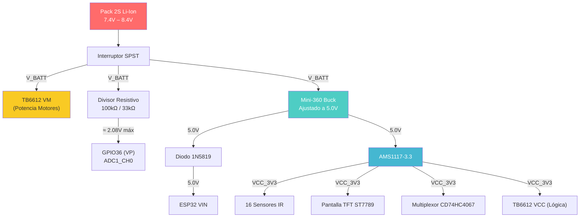

# Catálogo de Componentes - Proyecto Seguidor de Línea

Documento técnico descriptivo con imágenes de los componentes empleados en el diseño y construcción del robot seguidor de línea.

---

## 1. Micro Pulsador Táctil (Tactile Push Button 2 Pines)

- **Tipo de Componente:** Pulsador mecánico de contacto momentáneo (Normalmente Abierto - NO)
- **Dimensiones:** 6 x 6 x 6 mm
- **Pines / Montaje:** 2 Pines (DIP / Through-Hole)
- **Función en el Robot:** Interfaz de usuario básica para inicio de carrera (Start), parada, selección de perfiles de velocidad o calibración de sensores en pista.
- **Características:** Respuesta táctil definida (click), bajo rebote mecánico, fácil integración en PCB.

**Imágenes:**
- *Vista del componente:* `assets/pulsador_tactil_2pin.png`

---

## 2. Pantalla Display TFT Color 1.54" SPI (Controlador ST7789)

- **Tipo de Pantalla:** Módulo TFT IPS LCD Full Color
- **Tamaño y Resolución:** 1.54 pulgadas, 240 x 240 píxeles
- **Controlador Gráfico:** ST7789 (Versión de placa: 1.54TFT-SPI-ST7789 Ver: 1.1)
- **Interfaz de Comunicación:** SPI de alta velocidad (Pines: GND, VCC, SCL, SDA, RST, DC, CS, BL)
- **Control de Retroiluminación:** Pin BL para control de brillo o encendido/apagado por PWM
- **Función en el Robot:** Telemetría en tiempo real: visualización del estado de sensores, menú interactivo de calibración, lectura de voltaje de batería, tiempos de vuelta y ajustes de constantes PID.
- **Ventajas:** Panel IPS con amplio ángulo de visión y excelente nitidez bajo iluminación de competencia.

**Imágenes:**
- *Vista Frontal:* `assets/pantalla_tft_1_54_frontal.png`
- *Vista Trasera (Pinout y serigrafía):* `assets/pantalla_tft_1_54_trasera.png`

---

## 3. Módulo Regulador Reductor de Voltaje Step-Down Mini-360 (HW-187)

- **Tipo de Componente:** Convertidor DC-DC Buck reductor síncrono conmutado
- **Circuito Integrado:** Monolithic Power Systems MP2307DN
- **Voltaje de Entrada:** 4.75V a 23V DC (ideal para paquetes LiPo 2S o 3S de 7.4V / 11.1V)
- **Voltaje de Salida:** 1.0V a 17V DC (ajustable mediante potenciómetro multivuelta integrado)
- **Corriente de Salida:** 1.8A nominal continuo (pico de hasta 3A con disipación adecuada)
- **Frecuencia de Conmutación:** ~340 kHz (alta eficiencia energética >90%, mínimo calentamiento)
- **Función en el Robot:** Alimentación y regulación de la línea de 5V / 3.3V para la electrónica de control (ESP32, display TFT y sensores) de forma aislada y eficiente frente a las caídas de tensión bruscas causadas por los motores.
- **Ventajas:** Factor de forma ultra compacto y peso sumamente reducido, esencial para minimizar la inercia del robot.

**Imágenes:**
- *Vista Superior (Inductor 100, IC MP2307 y potenciómetro de ajuste):* `assets/regulador_mini360_frontal.png`
- *Vista Inferior (Serigrafía HW-187, pads IN+/IN- y OUT+/OUT-):* `assets/regulador_mini360_trasera.png`

---

## 4. Módulo Microcontrolador ESP32 DevKit V1 (38 Pines, USB Tipo C)

- **Tipo de Componente:** Placa de desarrollo con microcontrolador de doble núcleo y conectividad inalámbrica
- **Procesador Central:** Xtensa® Dual-Core 32-bit LX6 operando a una frecuencia de hasta 240 MHz
- **Memoria:** 520 KB SRAM interna + 4 MB Flash SPI externa
- **Conectividad:** Wi-Fi 802.11 b/g/n + Bluetooth v4.2 BR/EDR y BLE (Bluetooth Low Energy)
- **Interfaz USB:** Conector USB Tipo C moderno con conversor serial integrado para programación rápida y telemetría por consola UART
- **Distribución de Pines:** Versión de 38 pines (19 por lado), con múltiples canales ADC de alta resolución, periféricos de temporización por hardware (PWM de alta frecuencia para motores) y buses SPI/I2C dedicados
- **Botones Integrados:** Botón de Reset (EN / RST) y botón de arranque/modo de carga (BOOT)
- **Función en el Robot:** Cerebro central del seguidor de línea: ejecuta el algoritmo de control de lazo cerrado (PID), procesa las lecturas de los sensores ópticos de línea a alta frecuencia de muestreo, genera las señales PWM hacia los drivers de motor y gestiona la interfaz gráfica de usuario en pantalla TFT o telemetría inalámbrica vía Bluetooth/Wi-Fi.

**Imágenes:**
- *Vista Superior (Módulo blindado ESP-WROOM-32, puerto USB-C, regulador y botones RST/BOOT):* `assets/esp32_devkit_v1_frontal.png`
- *Vista Inferior (Pinout rotulado y pines header macho):* `assets/esp32_devkit_v1_trasera.png`

---

## 5. Módulo Multiplexor / Demultiplexor Analógico-Digital de 16 Canales (CD74HC4067)

- **Tipo de Componente:** Multiplexor / demultiplexor analógico bidireccional de 16 a 1 (16-Channel Analog/Digital Multiplexer Breakout V599)
- **Circuito Integrado:** Texas Instruments CD74HC4067SM96
- **Voltaje de Operación:** 2V a 6V DC
- **Canales de Entrada/Salida:** 16 canales independientes (C0 a C15) conmutados hacia un único pin de señal común (SIG)
- **Líneas de Control:** 4 líneas de dirección digital binaria (S0, S1, S2, S3) y 1 pin de habilitación activa en bajo (EN)
- **Resistencia 'ON':** Típicamente ~70 Ω a 4.5V (baja resistencia interna para mínima distorsión de señal)
- **Función en el Robot:** Expansor analógico para la barra frontal de sensores reflectivos. Permite leer hasta 16 sensores infrarrojos utilizando únicamente 1 pin ADC del ESP32 y 4 pines GPIO digitales de selección, liberando pines del microcontrolador y evitando la limitación de canales ADC cuando el Wi-Fi está en uso.

**Imágenes:**
- *Vista Superior (IC CD74HC4067, serigrafía de canales C0-C15, SIG, S0-S3, EN, VCC, GND):* `assets/multiplexor_cd74hc4067.png`

---

## 6. Módulo Sensor Infrarrojo Reflectivo Miniatura QRE1113

- **Tipo de Componente:** Módulo sensor óptico de reflexión por infrarrojos (IR Reflectance Sensor)
- **Elemento Sensor:** Fototransistor emisor/receptor IR SMD QRE1113
- **Longitud de Onda:** Emisor LED infrarrojo de 940 nm con fototransistor NPN de silicio filtrado para luz visible
- **Distancia Óptima de Sensado:** 1.0 mm a 3.0 mm (distancia típica respecto a la pista de carreras)
- **Voltaje de Operación:** 3.3V a 5.0V DC (compatible directamente con niveles lógicos de 3.3V del ESP32)
- **Conexiones:** 3 pines: VCC, GND y Señal OUT
- **Función en el Robot:** Detección de contraste entre la línea de la pista (negra/blanca) y el fondo. Varios de estos módulos forman la barra frontal de lectura para calcular el error de trayectoria mediante promedio ponderado en el algoritmo PID.
- **Ventajas:** Dimensiones extremadamente reducidas (placa PCB roja miniatura con orificio de montaje), bajo consumo y tiempo de respuesta veloz ideal para seguimiento a alta velocidad.

**Imágenes:**
- *Vista Frontal (Sensor óptico QRE1113 central y resistencias SMD):* `assets/sensor_qre1113_frontal.png`
- *Vista Trasera (Serigrafía de terminales GND, OUT, VCC):* `assets/sensor_qre1113_trasera.png`

---

## 7. Módulo Controlador de Motores Puente H Dual TB6612FNG

- **Tipo de Componente:** Driver de potencia para motores de corriente continua (Dual H-Bridge Motor Driver)
- **Circuito Integrado:** Toshiba TB6612FNG
- **Voltaje de Alimentación de Motores (VM):** 4.5V a 15V DC (óptimo para paquetes de baterías de 2 celdas 7.4V / 8.4V)
- **Voltaje de Lógica (VCC):** 2.7V a 5.5V DC (compatible nativamente con niveles de 3.3V del microcontrolador)
- **Capacidad de Corriente:** 1.2A continuos por canal (pico de 3.2A por canal con pulsos breves)
- **Modos de Control:** Adelante, reversa, freno libre (coast) y freno dinámico (brake por cortocircuito de armadura). Entrada STBY para apagado total de bajo consumo.
- **Frecuencia PWM:** Soporta modulación por ancho de pulso de hasta 100 kHz (elimina zumbidos audibles y optimiza el par motor).
- **Desacoplo y Filtrado:**
  - *Etapa de Potencia (VM a GND):* Capacitor cerámico de $100\,\text{nF}$ en paralelo con electrolítico de $470\,\mu\text{F}$ para amortiguar picos inductivos de conmutación.
  - *Etapa Lógica (Pin 2 VCC a Pin 3 GND):* Capacitor cerámico de $100\,\text{nF}$ de desacoplo colocado inmediatamente junto a los pines 2 y 3 para filtrar el ruido digital y estabilizar la lógica interna del driver.
- **Función en el Robot:** Actuador de potencia principal que recibe las señales PWM calculadas por el algoritmo PID del ESP32 para dosificar la velocidad y el giro diferencial de los micromotores N20. Mucho más eficiente que los antiguos L298N gracias a sus transistores MOSFET internos de baja caída de tensión.

**Imágenes:**
- *Vista Superior (IC TB6612FNG, capacitor de tántalo y circuito periférico):* `assets/driver_tb6612fng_frontal.png`
- *Vista Inferior (Serigrafía detallada de pines: PWMA, AIN1, AIN2, STBY, BIN1, BIN2, PWMB, VM, VCC, AO1, AO2, BO1, BO2, GND):* `assets/driver_tb6612fng_trasera.png`

---

## 8. Micromotores DC con Reductora Metálica (Micro Metal Gearmotor N20)

- **Tipo de Componente:** Actuador electromecánico rotativo DC miniatura
- **Factor de Forma:** N20 con caja reductora completamente metálica (all-metal spur gearbox)
- **Voltaje Nominal de Trabajo:** 6V - 12V DC
- **Eje de Salida:** Eje en "D" de 3 mm de diámetro (diseñado para acople seguro con ruedas de goma o llantas de silicona de competición)
- **Características:** Cuerpo compacto y ligero, engranajes de latón/acero de alta resistencia al torque, escobillas metálicas para respuesta dinámica inmediata.
- **Función en el Robot:** Tracción y direccionamiento diferencial del vehículo. Su rápida aceleración y frenada permiten cambios bruscos de dirección al trazar curvas cerradas a alta velocidad.

**Imágenes:**
- *Vista del par de motores N20 (Cajas reductoras doradas, ejes tipo D y terminales de soldadura traseros):* `assets/micromotores_n20.png`

---

## 9. Baterías Recargables Li-Ion 18650 Samsung INR18650-30Q (Pack 2S)

- **Tipo de Componente:** Celdas de Ion de Litio (Li-ion) cilíndricas de alta descarga
- **Fabricante y Modelo:** Samsung SDI - INR18650-30Q
- **Voltaje Nominal:** 3.6V - 3.7V por celda (7.2V - 7.4V en configuración 2S; 8.4V a carga completa)
- **Capacidad Nominal:** 3000 mAh por celda
- **Corriente de Descarga Continua (CDR):** 15A continuo (hasta 25A en pulsos cortos)
- **Química Interna:** INR (Níquel-Manganeso-Cobalto / NMC), ofrece alta densidad energética y excelente estabilidad térmica bajo alta demanda.
- **Función en el Robot:** Fuente principal de energía para todo el sistema (etapa de potencia de motores mediante el driver TB6612FNG y etapa de control a través del regulador reductor Mini-360). Su alta tasa de descarga asegura que la tensión no decaiga ante aceleraciones súbitas de los motores.

**Imágenes:**
- *Vista del pack de celdas Samsung 30Q (Envoltura rosada con códigos de lote INR18650-30Q Samsung SDI):* `assets/baterias_18650_samsung_30q.png`

---
## 10. Arquitectura Eléctrica y Distribución de Potencia

El sistema de distribución de potencia del robot se organiza en **tres rieles de alimentación independientes**, diseñados para aislar las fuentes de ruido eléctrico y garantizar la estabilidad del microcontrolador y los sensores analógicos durante la operación a máxima velocidad.

### Línea de Potencia ($V_{BATT}$: 7.4V – 8.4V)

- Batería 2S Li-Ion conectada mediante interruptor SPST externo (**SW_EXT**).
  - *Requerimiento del interruptor:* Clasificado para $\ge 3\,\text{A DC}$ continuo (capaz de absorber la corriente de inserción (*inrush*) de carga del capacitor de $470\,\mu\text{F}$ y los picos transitorios de los motores).
  - *Ajuste en PCB:* Taladros agrandados a **1.2 mm – 1.5 mm** en la huella del PCB para permitir soldar cables flexibles de panel de calibre AWG 18–20.
- Alimenta directamente el pin **VM** del TB6612FNG (con capacitor cerámico de $100\,\text{nF}$ y electrolítico de $470\,\mu\text{F}$ en paralelo para filtrado de picos inductivos).
- Alimenta la entrada **IN+** del regulador Mini-360 ajustado a $5.0\,\text{V}$.
- Conectada al divisor de tensión resistivo ($100\,\text{k}\Omega$ / $33\,\text{k}\Omega$ con capacitor cerámico de filtro de $100\,\text{nF}$) para monitoreo en **GPIO36 (VP)**. Escala:

$$V_{adc} = V_{bat} \times \frac{33\text{k}}{100\text{k} + 33\text{k}} \approx 2.08\,\text{V máximo a } 8.4\,\text{V}$$

> [!TIP]
> **Justificación técnica 100k / 33k vs. 22k:**  
> La recomendación de usar $22\,\text{k}\Omega$ se fundamenta en baterías 3S ($11.1\,\text{V} - 12.6\,\text{V}$), donde $12.6\,\text{V}$ entrega $\sim 2.27\,\text{V}$ al ADC. En un sistema 2S ($7.4\,\text{V} - 8.4\,\text{V}$), una resistencia de $22\,\text{k}\Omega$ produciría solo $1.52\,\text{V}$ a carga completa, desaprovechando cerca del $40\%$ del rango dinámico del ADC de 12 bits del ESP32.  
> Con $33\,\text{k}\Omega$, a $8.4\,\text{V}$ se obtienen exactamente **$2.08\,\text{V}$**, situándose en la región de mayor linealidad del ADC del ESP32 (atenuación de 11 dB, lineal entre $0.15\,\text{V}$ y $2.45\,\text{V}$), maximizando la resolución por paso sin riesgo de saturación.

### Línea de 5.0V (Salida del Mini-360)

- Protegida con **diodo Schottky 1N5819** hacia el pin **VIN** del ESP32 (evita retroalimentación desde USB durante programación).
- Alimenta la entrada **IN** del regulador lineal AMS1117-3.3 (con capacitor de $10\,\mu\text{F}$ a GND en entrada y salida).

### Línea de 3.3V Aislada ($VCC_{3V3}$, generada por AMS1117-3.3)

- Capacitor de salida de $10\,\mu\text{F}$ a GND.
- Alimenta exclusivamente:
  - Los **16 sensores IR** (QRE1113).
  - La **pantalla TFT** (VCC y retroiluminación BL).
  - El **multiplexor CD74HC4067**.
  - La **lógica VCC** del TB6612 (Pin 2 con capacitor local de $100\,\text{nF}$ a GND en Pin 3).
- El pin **3V3** del ESP32 queda libre/desconectado para no sobrecargar su regulador interno AMS1117 integrado.

> [!IMPORTANT]
> **Nota de diseño:** Esta topología de tres rieles aísla completamente el ruido inductivo de los motores de la alimentación de los sensores analógicos y la lógica digital, previniendo reinicios por *Brownout*.

### Diagrama de Distribución de Potencia

---

## 11. Mapeo Definitivo de Pines del ESP32 (Pinout)

Asignación definitiva de pines del **ESP32 DevKit V1 (38 pines)** para el robot seguidor de línea. Cada GPIO ha sido seleccionado considerando las restricciones de hardware del ESP32 (pines solo entrada, conflictos con ADC2/Wi-Fi, estado durante el arranque, buses SPI nativos).

| Pin Físico | GPIO | Función / Etiqueta | Descripción |
| :--- | :--- | :--- | :--- |
| P36 (VP) | GPIO36 | `BATT_SENSE` | Lectura analógica de batería (ADC1_CH0). Escala $8.4\,\text{V} \rightarrow \sim2.08\,\text{V}$. |
| P39 (VN) | GPIO39 | `MUX_SIG` | Lectura analógica del sensor seleccionado por el multiplexor (ADC1_CH3). |
| P32 | GPIO32 | `BTN_CALIB` | Pulsador de calibración de sensores en pista. Pull-up $10\,\text{k}\Omega$ a $VCC_{3V3}$. |
| P33 | GPIO33 | `BTN_START` | Pulsador de inicio de carrera (Start). Pull-up $10\,\text{k}\Omega$ a $VCC_{3V3}$. |
| P27 | GPIO27 | `MUX_S0` | Línea de selección S0 (bit 0) del CD74HC4067. |
| P14 | GPIO14 | `MUX_S1` | Línea de selección S1 (bit 1) del CD74HC4067. |
| P13 | GPIO13 | `MUX_S2` | Línea de selección S2 (bit 2) del CD74HC4067. |
| P15 | GPIO15 | `MUX_S3` | Línea de selección S3 (bit 3) del CD74HC4067. |
| P12 | GPIO12 | `STBY` | Habilitador de motores TB6612 (con pull-down de $10\,\text{k}\Omega$ a GND). |
| P21 | GPIO21 | `M1_IN1` | Dirección A del Motor Izquierdo (AIN1). |
| P22 | GPIO22 | `M1_IN2` | Dirección B del Motor Izquierdo (AIN2). |
| P4 | GPIO4 | `M1_PWM` | Velocidad PWM del Motor Izquierdo (PWMA). |
| P25 | GPIO25 | `M2_IN1` | Dirección A del Motor Derecho (BIN1). |
| P26 | GPIO26 | `M2_IN2` | Dirección B del Motor Derecho (BIN2). |
| P17 | GPIO17 | `M2_PWM` | Velocidad PWM del Motor Derecho (PWMB). |
| P18 | GPIO18 | `SPI_SCK` | Reloj SPI para pantalla TFT ST7789. |
| P23 | GPIO23 | `SPI_MOSI` | Datos SPI para pantalla TFT ST7789. |
| P19 | GPIO19 | `TFT_DC` | Selector Datos / Comando de la pantalla TFT. |
| P5 | GPIO5 | `TFT_CS` | Chip Select de la pantalla TFT. |
| P16 | GPIO16 | `TFT_RST` | Reset de la pantalla TFT. |

> [!NOTE]
> **Restricciones de pines consideradas:**
> - **GPIO36 y GPIO39** son solo entrada (*input-only*), ideales para ADC.
> - **GPIO12** tiene restricción de boot (debe estar LOW al encender), por eso se usa con pull-down para STBY.
> - Se evita usar **ADC2** (GPIOs 0, 2, 4, 12-15, 25-27) para lectura analógica porque conflicta con Wi-Fi. Las lecturas analógicas usan exclusivamente **ADC1**.
> - Los pines SPI (18, 23) corresponden al bus **VSPI nativo** del ESP32.

---

## 12. Distribución de Canales del Multiplexor (CD74HC4067)

Los 16 canales del multiplexor CD74HC4067 se distribuyen en **tres grupos lógicos** correspondientes a la disposición física de los sensores en el chasis del robot: dos aletas laterales desplegables y una barra central fija.

| Canal | Dirección (S3 S2 S1 S0) | Grupo | Sensor / Posición |
| :--- | :---: | :--- | :--- |
| C0 | `0000` | Aleta Izquierda | Sensor exterior izquierdo 1 (más alejado) |
| C1 | `0001` | Aleta Izquierda | Sensor exterior izquierdo 2 |
| C2 | `0010` | Aleta Izquierda | Sensor exterior izquierdo 3 |
| C3 | `0011` | Aleta Izquierda | Sensor exterior izquierdo 4 (más cercano al centro) |
| C4 | `0100` | Barra Central | Sensor central 1 (extremo izquierdo de la barra) |
| C5 | `0101` | Barra Central | Sensor central 2 |
| C6 | `0110` | Barra Central | Sensor central 3 |
| C7 | `0111` | Barra Central | Sensor central 4 |
| C8 | `1000` | Barra Central | Sensor central 5 |
| C9 | `1001` | Barra Central | Sensor central 6 |
| C10 | `1010` | Barra Central | Sensor central 7 |
| C11 | `1011` | Barra Central | Sensor central 8 (extremo derecho de la barra) |
| C12 | `1100` | Aleta Derecha | Sensor exterior derecho 1 (más cercano al centro) |
| C13 | `1101` | Aleta Derecha | Sensor exterior derecho 2 |
| C14 | `1110` | Aleta Derecha | Sensor exterior derecho 3 |
| C15 | `1111` | Aleta Derecha | Sensor exterior derecho 4 (más alejado) |

### Modos de Operación

- **Modo 8 sensores:** Solo la barra central (C4–C11). Las aletas se desconectan físicamente. Ideal para pistas simples con curvas amplias.
- **Modo 16 sensores:** Barra central + ambas aletas. Para curvas cerradas y pistas más exigentes que requieren mayor cobertura de detección.

### Notas Técnicas

- El pin **EN** del multiplexor se conecta a **GND** (siempre habilitado, activo en bajo).
- El barrido completo de 16 canales toma menos de $500\,\mu\text{s}$ con lecturas ADC a 12 bits de resolución.

---

